# NovaWorks CRM - AI Meeting to Project CRM

A project management CRM for NovaWorks Technologies. The administrator pastes a meeting transcript, and AI creates the projects and tasks with the right manager, owner, deadline and estimated hours. Each logged-in user sees only the work they are allowed to see.

| | |
| --- | --- |
| **Live application** | https://infinity-hack-plum.vercel.app |
| **Demo video** | [Watch the demo](https://github.com/QURSAM-70179225/Infinity-Hackathon/blob/main/docs/demo/novaworks-demo.mp4) |
| **Repository** | https://github.com/QURSAM-70179225/Infinity-Hackathon |

Log in with any demo account below (password `Demo123!`), for example `admin@novaworks.example`. The backend runs on a free Render service; if the first login takes up to a minute, it was waking up.

## Team
- Team name: [team name]
- Four members and responsibilities:
  - Qursam Bibi (leader): integration, testing, README, deployment, demo
  - Abdul Hameed: frontend (login, dashboard, project and task screens)
  - Ali Mumtaz: backend (database, seeding, login, role-based access)
  - Muzammil Hussain: AI (prompt, transcript conversion, validation, all-or-nothing save)
- Repository: https://github.com/QURSAM-70179225/Infinity-Hackathon

## Demo Video
[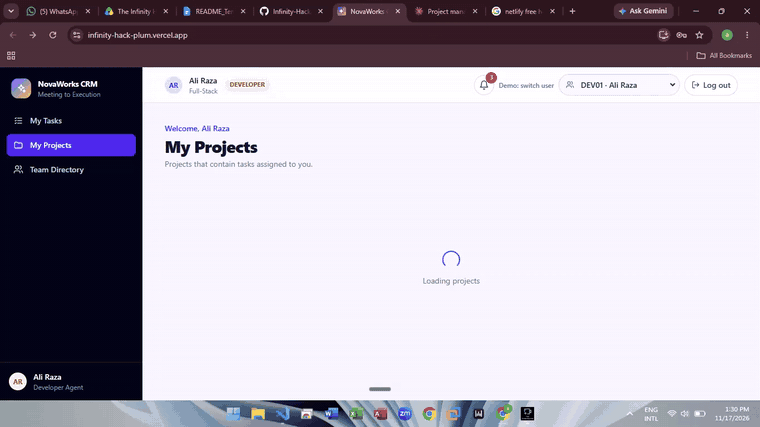](https://github.com/QURSAM-70179225/Infinity-Hackathon/blob/main/docs/demo/novaworks-demo.mp4)

**[Watch the full demo video (1 min 40 s)](https://github.com/QURSAM-70179225/Infinity-Hackathon/blob/main/docs/demo/novaworks-demo.mp4)**. The animated preview above plays at double speed. The video file is also in this repository at `docs/demo/novaworks-demo.mp4`.

What the video shows, on the live site:
1. Logging in with a demo account.
2. The Team Directory with reference codes, roles and capacity bars.
3. A project's tasks on the Kanban board, with overdue deadlines in red.
4. Switching to Hina Malik (manager): only her project.
5. Switching to Hamza Shah (developer): My Tasks and his board show only his own tasks.

## Screenshots
**Login** with the ten demo accounts and their reference codes
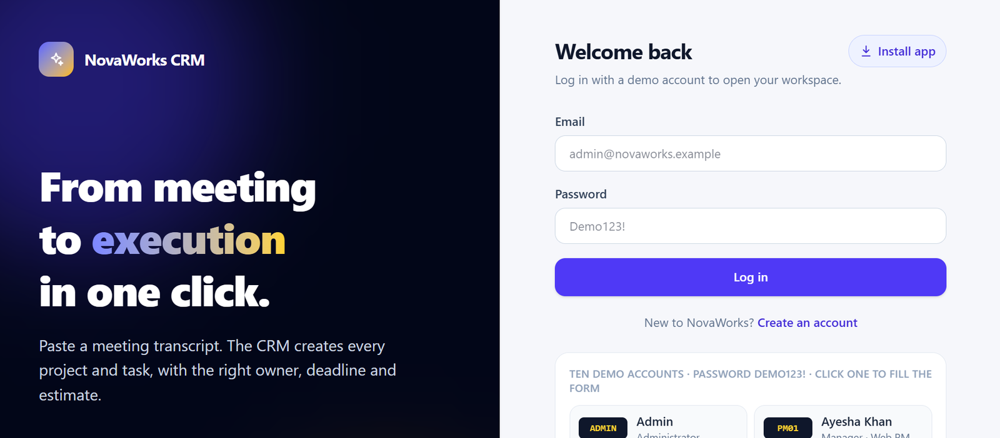

**Admin dashboard** after Create from Transcript: 3 projects, 12 tasks
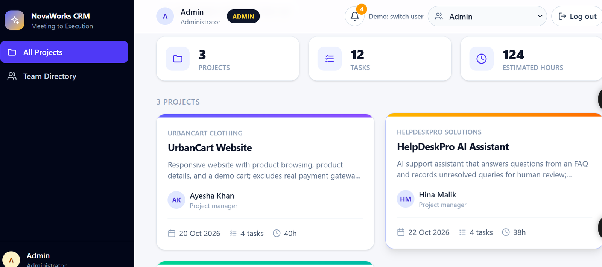

**Project detail**: client, manager, deadline 20 Oct 2026, 40 hours
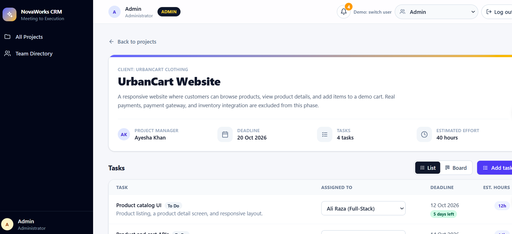

**Task list** with owners, deadlines, time left and estimated hours
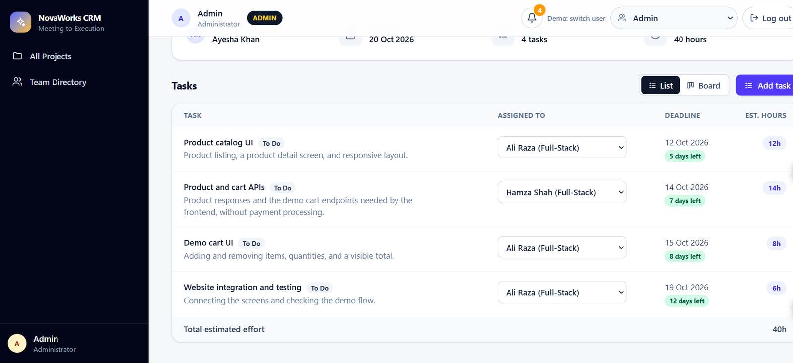

**Kanban board**: To Do, In Progress, Done
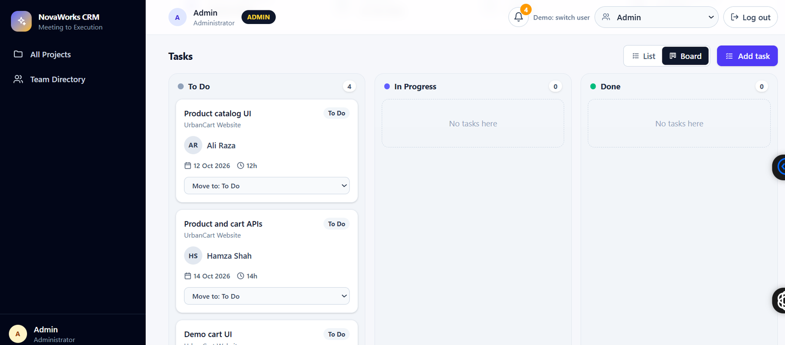

**Team directory** with reference codes, role control and 40 hour capacity bars
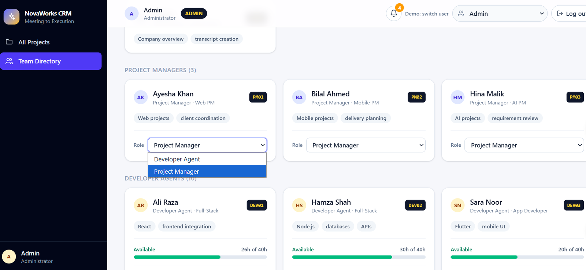

| Demo user switcher | On a phone | Installed app |
| --- | --- | --- |
| 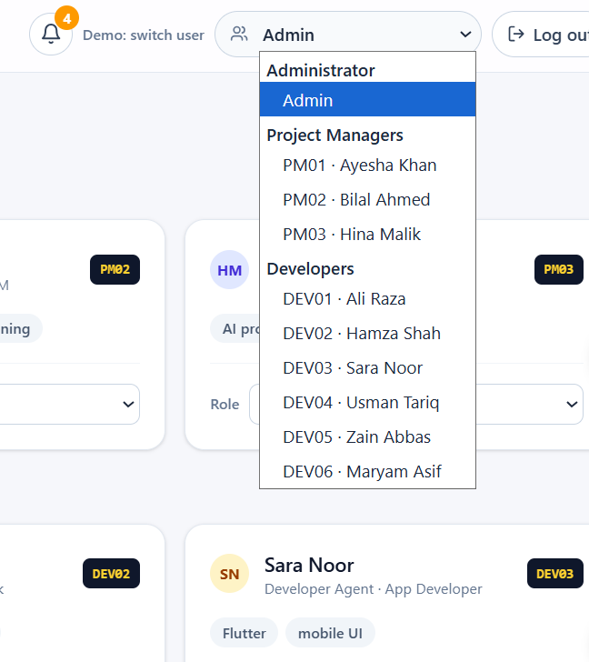 | 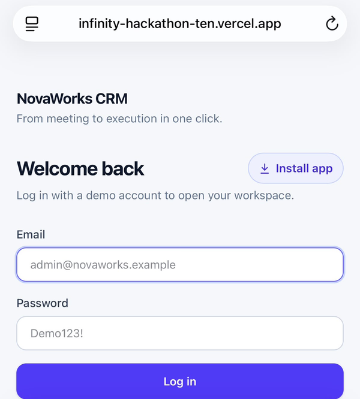 | 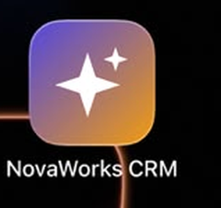 |

## Judges Guide
A five-minute path through everything the challenge asks for. Use the **Demo: switch user** pill in the top bar to change accounts; it performs a real login each time.

| # | Do this | You should see |
| --- | --- | --- |
| 1 | Open https://infinity-hack-plum.vercel.app and log in as **Admin** (click the ADMIN chip, then Log in) | Admin home with Create from Transcript |
| 2 | Click **Use supplied transcript**, then **Create from Transcript** | "Created 3 projects and 12 tasks" and three project cards |
| 3 | Open **UrbanCart Website** | Manager Ayesha Khan, deadline 20 Oct 2026, four tasks, 40 hours |
| 4 | Check the corrected decisions | UrbanCart deadline is 20 Oct (not 18). Website integration is due 19 Oct (not 17). QuickServe integration is 10h (not 8). HelpDeskPro testing belongs to Maryam (not Zain) |
| 5 | Check what is absent | No Kamran. No payment, inventory, maps or email tasks |
| 6 | Switch to **Ayesha Khan** | Only UrbanCart Website |
| 7 | Switch to **Ali Raza** | My Tasks with only his three UrbanCart tasks |
| 8 | Switch to **Hamza Shah** | Two API tasks across UrbanCart and QuickServe |
| 9 | As Ayesha or Ali, change the number in the address bar (`/projects/<id>`) to another project | "You do not have access to this project"; the API answers 403 |
| 10 | Refresh the page | Projects and tasks are still there |
| 11 | As Admin, click **Reset demo data**, paste a changed transcript (for example QuickServe integration 12 hours, due 23 October, changed in both the 09:28 section and the final recap) and create again | Only that task has the new values |

Hours per project for verification: UrbanCart 40, QuickServe 46, HelpDeskPro 38.

To reset between tests, log in as Admin and click **Reset demo data**. It deletes generated projects and tasks and keeps the users. Creating again from a transcript also replaces projects that have the same name.

Extras you can try: the **Board** view on a project or on My Tasks, the capacity bars in **Team Directory**, the reminder bell, and **Install app** on a phone.

## What Works
**Required by the challenge**
- Login and logout with the ten supplied demo accounts.
- Admin home: all project cards, totals, and Create from Transcript.
- Transcript automation: AI reads the meeting with the team directory and creates real project and task records. Loading, success and clear error states are shown.
- Validation before saving: managers must be managers, owners must be agents, hours must be positive, dates must be valid, and a task cannot be due after its project. If anything is unresolved, nothing is saved and the admin can correct the draft and save again.
- All-or-nothing save in one database transaction. Re-creating a project with the same name replaces it instead of duplicating it.
- Project detail: client, manager, deadline, and task rows with title, description, assigned agent, deadline and estimated hours.
- Manager view: only the projects they manage. Agent view: My Tasks, and only their own tasks inside related projects.
- Access rules are enforced in the API, not only in the interface.
- Team directory with names, specializations and reference codes.
- Saved records persist in a hosted PostgreSQL database (Supabase).

**Added on top**
- Kanban board: tasks in To Do, In Progress and Done, on each project and on My Tasks. Cards can be dragged between columns or moved with a status dropdown. See [Kanban board](#kanban-board).
- Developer workload: each developer's total estimated hours against a 40 hour capacity (green up to 32h, yellow up to 40h, red above 40h), with capacity bars and overload warnings. A manager sees only developers on their projects, as hour totals.
- Overload review before saving: if a transcript would put a developer above 40 hours, nothing is saved. The admin can reassign tasks with live recalculation or a one-click suggestion, then save. The supplied transcript stays within capacity, so it saves directly.
- Manual management: the admin can create a project by hand, assign a manager, and change a member between agent and manager. The admin and the project's manager can add tasks and reassign them.
- Signup for company emails only (`@novaworks.example`). A new account is always a developer agent, so signup cannot give anyone admin or manager access.
- Deadline reminders: a bell lists the user's tasks due within 7 days or overdue, and each task row shows the time left. Measured from the meeting date in the scenario (7 Oct 2026, `VITE_DEMO_DATE`).
- Demo user switcher in the top bar: a real login as the chosen demo account, so every screen reloads with that user's own permissions.
- Installable app: an **Install app** button adds the CRM to a phone's home screen or a laptop with its own icon. The layout adapts to phone, tablet and laptop widths.
- Reset demo data button (admin).

Not included: forgot password, email verification, cost calculation, time tracking. Deleting a single project or task is not built; the admin can reset all generated work.

## Architecture
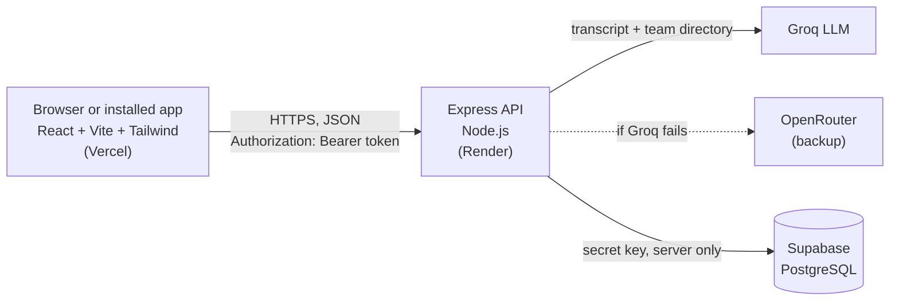

How a transcript becomes saved work:
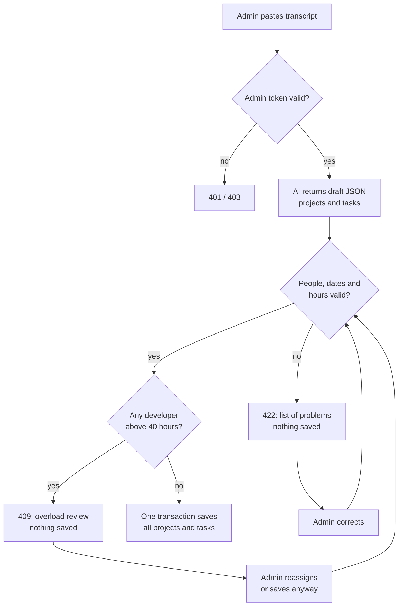

More detail, including the full list of API routes, is in [docs/ARCHITECTURE.md](docs/ARCHITECTURE.md).

## Database
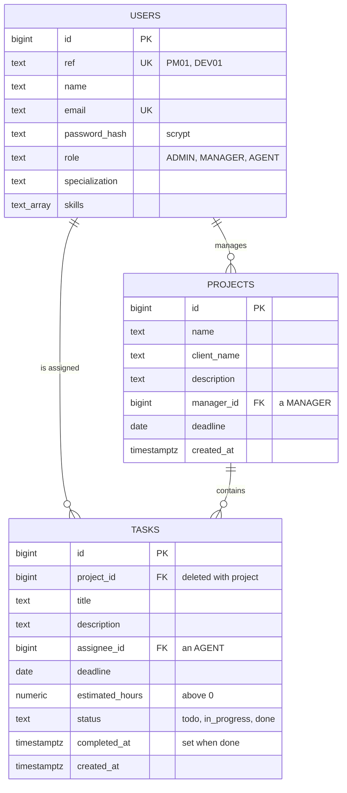
One manager has many projects, one project has many tasks, and one agent has many tasks across projects. The schema is in `backend/sql/schema.sql`. Setup notes are in [docs/DATABASE.md](docs/DATABASE.md).

## Technology Stack
- Frontend: React 19 with Vite, Tailwind CSS 4, React Router 7
- Backend: Node.js 18+ with Express 5
- Database: PostgreSQL hosted on Supabase, accessed with `@supabase/supabase-js`
- AI: Groq chat completions API. The backend picks an available model automatically (`llama-3.3-70b-versatile` preferred), or uses `GROQ_MODEL` if set. OpenRouter is the backup provider.
- Authentication/session approach: passwords are hashed with scrypt. Login returns a signed token (JWT format, HS256, 8 hours). Every request sends it in the `Authorization` header, and the backend loads the user from the database using the token. The role is never taken from the browser.

## Links
- Live application: https://infinity-hack-plum.vercel.app
- Demo video: [Watch the demo](https://github.com/QURSAM-70179225/Infinity-Hackathon/blob/main/docs/demo/novaworks-demo.mp4)

## Requirements
- Node.js 18 or newer, with npm
- A Supabase project (free)
- A Groq API key (free). Optional: an OpenRouter key as backup

## Run Locally
1. Clone this repository and enter its directory:
   ```sh
   git clone https://github.com/QURSAM-70179225/Infinity-Hackathon.git
   cd Infinity-Hackathon
   ```
2. Install dependencies:
   ```sh
   cd backend
   npm install
   cd ../frontend
   npm install
   cd ..
   ```
3. Copy the environment templates:
   ```sh
   copy backend\.env.example backend\.env
   copy frontend\.env.example frontend\.env
   ```
   On macOS or Linux use `cp` instead of `copy`.
4. Fill in `backend/.env` with your own values (see Environment Variables).
5. Create the database: create a project at supabase.com, then copy the Project URL and the secret key (`sb_secret_...`) from Settings > API Keys into `backend/.env`.
6. Apply the schema: open the Supabase SQL Editor, paste the contents of `backend/sql/schema.sql`, and click Run. It is safe to run again; it also adds new columns to an existing database.
7. Seed all ten demo users. Re-running does not duplicate users:
   ```sh
   cd backend
   npm run seed
   ```
8. Start the backend and the frontend in two terminals. Both must stay running:
   ```sh
   # terminal 1 - API on http://localhost:5000
   cd backend
   npm run dev

   # terminal 2 - app on http://localhost:5173
   cd frontend
   npm run dev
   ```
   Open http://localhost:5173 in a browser.

## Environment Variables
| Variable | Purpose | Where configured |
| --- | --- | --- |
| `SUPABASE_URL` | Database project URL | backend |
| `SUPABASE_SECRET_KEY` | Database secret key | backend only |
| `GROQ_API_KEY` | AI provider credential | backend only |
| `GROQ_MODEL` | Optional: force a specific AI model | backend |
| `OPENROUTER_API_KEY` | Optional backup AI credential | backend only |
| `OPENROUTER_MODEL` | Optional backup model, default `openrouter/free` | backend |
| `SESSION_SECRET` | Signs login tokens | backend only |
| `CORS_ORIGIN` | Frontend URL allowed to call the API when deployed | backend |
| `DB_MODE` | `supabase` (default) or `local` for a file database | backend |
| `PORT` | API port, default 5000 | backend |
| `VITE_API_URL` | Local development only: backend address, default `http://localhost:5000`. The deployed site uses the forwarding in `frontend/vercel.json` | frontend |
| `VITE_DEMO_DATE` | Optional date that deadline reminders are measured from | frontend |

`.env.example` files with placeholders are in `backend/` and `frontend/`. Real keys are never committed. No AI or database secret is exposed to the browser.

## Demo Login Accounts
These emails are fictional identifiers, not mailboxes. The login page lists all ten; clicking one fills in the form.

| Code | Role | Name | Demo email | Password |
| --- | --- | --- | --- | --- |
| ADMIN | Admin | Admin | admin@novaworks.example | Demo123! |
| PM01 | Manager | Ayesha Khan | ayesha@novaworks.example | Demo123! |
| PM02 | Manager | Bilal Ahmed | bilal@novaworks.example | Demo123! |
| PM03 | Manager | Hina Malik | hina@novaworks.example | Demo123! |
| DEV01 | Agent | Ali Raza | ali@novaworks.example | Demo123! |
| DEV02 | Agent | Hamza Shah | hamza@novaworks.example | Demo123! |
| DEV03 | Agent | Sara Noor | sara@novaworks.example | Demo123! |
| DEV04 | Agent | Usman Tariq | usman@novaworks.example | Demo123! |
| DEV05 | Agent | Zain Abbas | zain@novaworks.example | Demo123! |
| DEV06 | Agent | Maryam Asif | maryam@novaworks.example | Demo123! |

Run `npm run seed` in `backend/` once before testing. It can be run again at any time.

## How Judges Can Test
The full step-by-step table is in the [Judges Guide](#judges-guide) above. In short:
1. Log in as admin; Create from Transcript is at the top of the home screen.
2. Click **Use supplied transcript** (the text is also in `docs/TRANSCRIPT.txt`).
3. Click **Create from Transcript**; expect three projects and twelve tasks.
4. Open UrbanCart: manager Ayesha, deadline 20 October 2026, four tasks.
5. Log in as Ayesha: only her assigned project appears.
6. Log in as Ali: only his three assigned UrbanCart tasks appear.
7. Log in as Hamza: his two API tasks span UrbanCart and QuickServe.
8. Other users' projects and tasks cannot be fetched directly; the API refuses.
9. Refresh to verify persistence.
10. Test a modified transcript to check the AI flow responds to changed input.

Reset between tests with **Reset demo data** on the admin home. Seeded users are kept.

## Kanban board
- Every task has a status: To Do, In Progress or Done. New tasks start in To Do.
- Open a project, or My Tasks, and choose **Board** next to **List**.
- Move a card by dragging it to another column, or with the **Move to** dropdown on the card. The dropdown works on touch screens and with a keyboard.
- The card moves at once. If the server refuses the change, the card moves back and a message appears.
- When a task reaches Done, the time is recorded in `completed_at`. Moving it out of Done clears it.
- Only saved tasks appear. A transcript draft that is still under review is never on the board.

Who can change a task's status (checked on the server):

| Role | Read the board | Change status |
| --- | --- | --- |
| Admin | Any project | Any task |
| Manager | Projects they manage | Tasks in those projects |
| Agent | Their own tasks | Their own tasks |

A request for someone else's project board or task answers 404. The status route accepts only the `status` field; any other field is refused with 400.

| Method | Route | Purpose |
| --- | --- | --- |
| GET | `/api/projects/:id/board` | Tasks of one project, grouped as `todo`, `in_progress`, `done` |
| GET | `/api/board/my-tasks` | Tasks assigned to the logged-in user, grouped the same way |
| PATCH | `/api/tasks/:id/status` | Body `{ "status": "todo" }`, `in_progress` or `done` |

## Tests
Eleven automated tests cover the board's permissions and rules. They use a temporary local database and a stand-in AI reply, so they need no keys, no internet, and never touch real data.
```sh
cd backend
npm test
```

## Deployment Details
- Deployment status: Live
- Frontend host: Vercel, https://infinity-hack-plum.vercel.app
- Backend host: Render, https://infinity-hackathon-9mbr.onrender.com
- Database: Supabase hosted PostgreSQL
- Deployed branch: `main` (Vercel and Render redeploy automatically on every push)

Full step-by-step instructions are in [docs/DEPLOYMENT.md](docs/DEPLOYMENT.md).

### How We Deployed
1. Frontend on Vercel: root directory `frontend`, build command `npm run build`, output directory `dist`. `frontend/vercel.json` forwards every `/api` request to the Render backend and sends all other routes to `index.html`, so the browser only ever talks to the Vercel domain.
2. Backend on Render (Web Service): root directory `backend`, build command `npm install`, start command `npm start`.
3. Database: the same Supabase project, reached over HTTPS. No extra SSL setup is needed.
4. Environment variables on Render: `SUPABASE_URL`, `SUPABASE_SECRET_KEY`, `GROQ_API_KEY`, `OPENROUTER_API_KEY`, `SESSION_SECRET`, `DB_MODE`, `CORS_ORIGIN`. On Vercel: `VITE_DEMO_DATE`.
5. Schema and seed: `backend/sql/schema.sql` was run in the Supabase SQL Editor, then `npm run seed` was run locally against the same database.
6. The Render URL is set once in `frontend/vercel.json`. `VITE_API_URL` is only used in local development.
7. Judges open the live link, log in with any demo account above, and use Create from Transcript as admin.

## Known Limitations
- The free AI tier has rate limits. If the AI is busy, the app shows a clear message and saves nothing; try again after a few seconds.
- A free Render service sleeps when idle, so the first request after a pause can take up to a minute.
- AI output can vary slightly in the wording of descriptions. Owners, dates and hours are validated before saving.
- The Install app button appears only where the browser supports installing (Chrome or Edge over HTTPS). On iPhone the app is added through Safari's Share menu.
- Dragging cards uses the browser's drag and drop, which most touch screens do not support. On a phone, use the Move to dropdown on the card.
- A task's owner and status can be changed in the interface. Other task fields can be changed through the API only.
- Accounts created through signup stay in the team directory; Reset demo data removes projects and tasks only.

## Project Structure
```
Infinity-Hackathon/
├── frontend/              # React app (Vite)
│   ├── public/            # App icons, manifest, service worker
│   └── src/
│       ├── components/    # Reusable UI (cards, table, board, forms)
│       ├── pages/         # Login, Signup, Dashboard, ProjectDetail, MyTasks, Team
│       ├── services/      # Calls to the backend API
│       └── utils/         # Login state, formatting, capacity and deadline rules
├── backend/               # Express server
│   ├── sql/               # Database schema
│   ├── src/
│   │   ├── routes/        # API routes
│   │   ├── middleware/    # Login and role checks
│   │   ├── controllers/   # Request handling
│   │   ├── services/      # Database, access rules, workload, AI
│   │   └── utils/         # Hashing, tokens, validation, demo users
│   └── tests/             # Automated tests
├── docs/                  # Architecture, database, deployment, demo script, screenshots
├── team/                  # One guide per team member
└── README.md
```

## License
Released under the MIT License. See [LICENSE](LICENSE).

Copyright (c) 2026 Abdul Hameed, Ali Mumtaz, Muzammil Hussain, Qursam Bibi.

## Submission Summary
- Source repository: https://github.com/QURSAM-70179225/Infinity-Hackathon
- Live link: https://infinity-hack-plum.vercel.app
- Demo video: [Watch the demo](https://github.com/QURSAM-70179225/Infinity-Hackathon/blob/main/docs/demo/novaworks-demo.mp4)
- Setup and seed commands: documented above
- Demo login accounts: listed above
- Features completed: login, role-based access enforced in the API, transcript to projects and tasks with validation, project and task screens, team directory, persistent hosted database, reset; plus Kanban board, workload and overload review, manual management, signup, reminders, installable app
